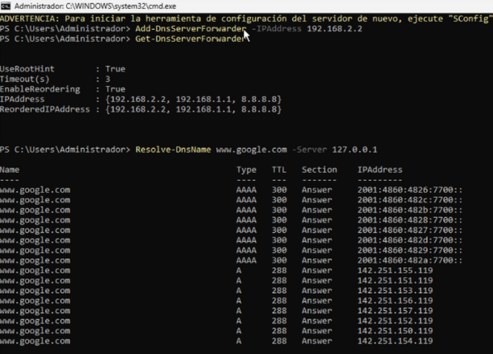
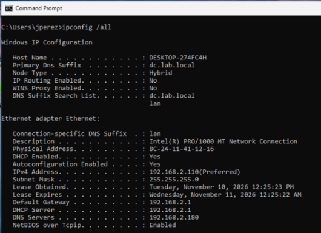

---

# Description

Domain Controller WIndows Server 2025 for testing

# VM Configuration

| Device            | Parameter                |
| ----------------- | ------------------------ |
| RAM               | 2GB                      |
| Processor         | 2 cores                  |
| Storage           | 32 GB                    |
| Network Interface | vmr0                     |
| Network Address   | 192.168.2.180            |
| OS                | Windows Server 2025 Core |
| DNS               | 192.168.2.180            |

# Issues when installing

*  Download and install driveres for virt-io
	* :**`virtio-win-gt-x64.msi`**

```powershell
Start-Process msiexec.exe -ArgumentList "/i D:\virtio-win-gt-x64.msi /qn /norestart" -Wait
```

* List adapters


* Now the required adapter is available


* Applying Fordwarders


# User Management

## Adding User as Example


Once the user was setted, we can login using the acccount with a new password 




# Backup 

> [!warning]
**Proxmox Replication:** **Disabled (Infeasible due to space constraints).**
The current local/remote storage does not meet the minimum quota required to support the disk size of this VM.

