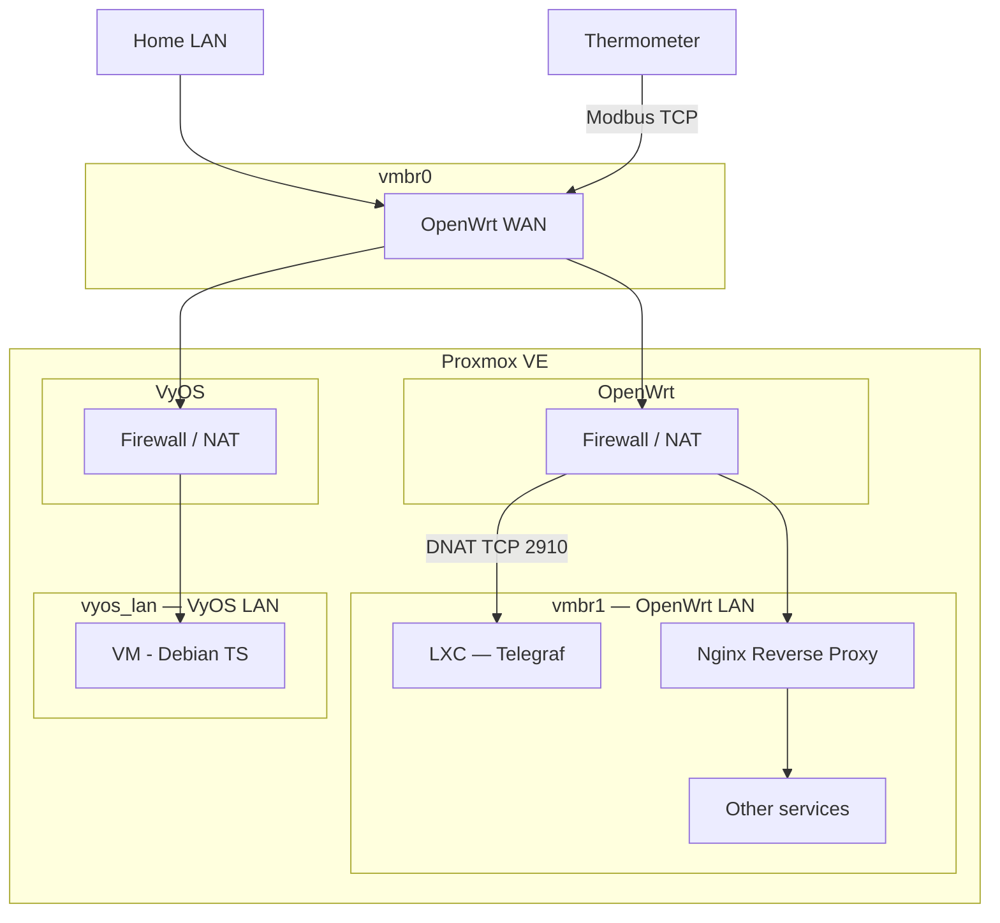

---

# Description

The simulated emviroment is composed by 2 VLANS created in the cluster. The first one has a [[OpenWRT]] virtualized router and the second one has a [[VyOS]] virtualized router. 

## Topology

