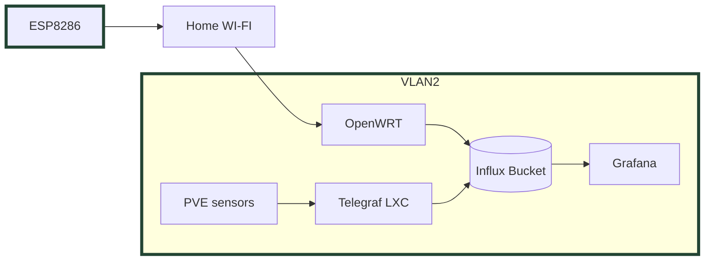

The data is created by ESP8266 temperature sensing, the data is handled at the end by a [[GRAFANA]] dashboard. The measurements are stored in a temporal series database implemented via [[INFLUXDB]]. The bucked is called Weather
 

