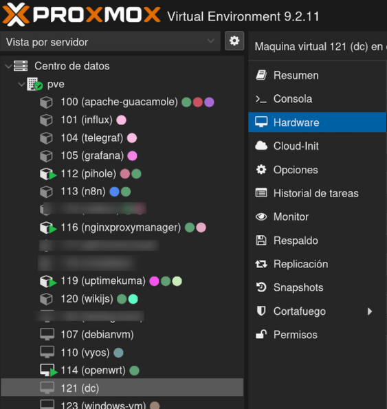

---

# Description

Runs Proxmox 9.2.3 with different virtualized services vía LXC y VMs.

# Network

PVE is connected to home LAN network. None of the LXCs or VMs are exposed directly to the Internet. PVE access can be achieved from internet via  Tailscale.
# Security

It use 2FA for WebGUI access. It also has dedicated users for basic administration.
